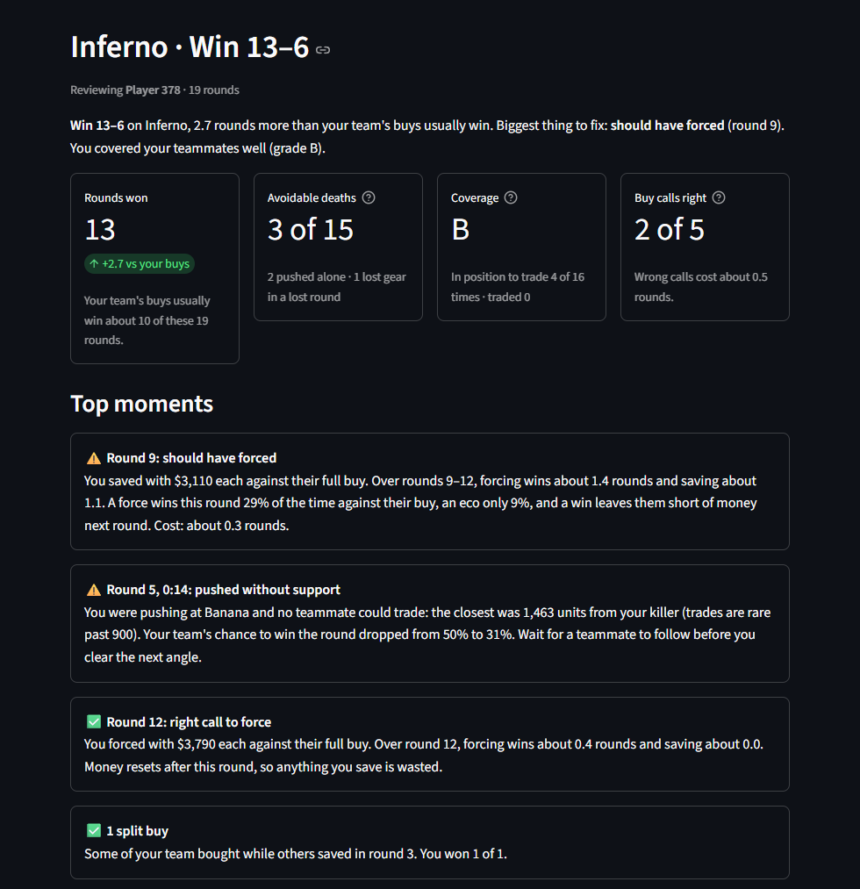
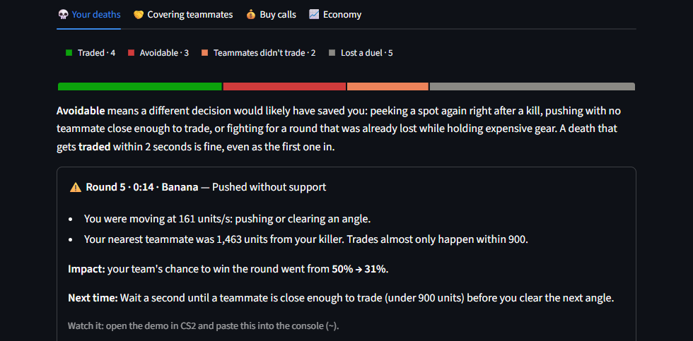
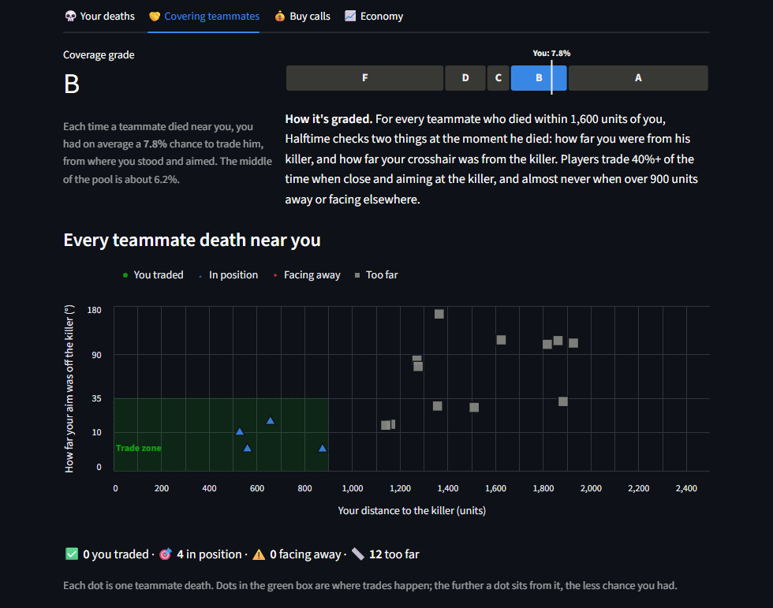
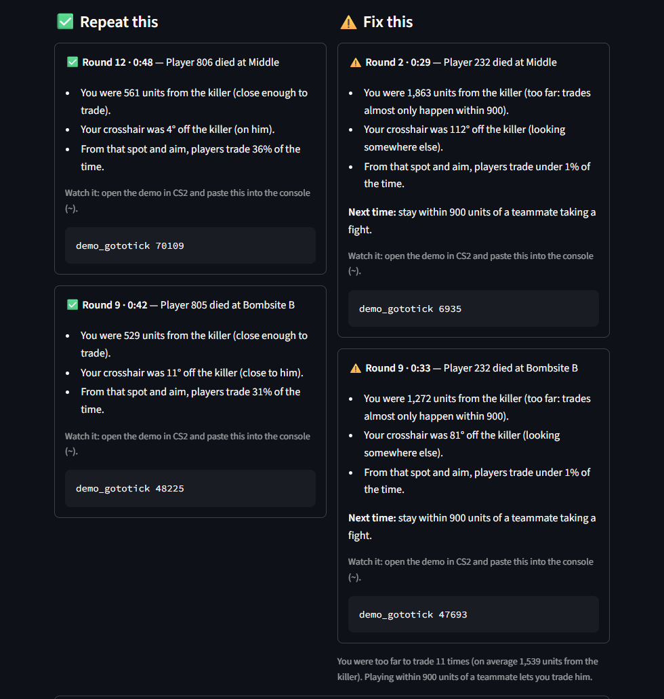
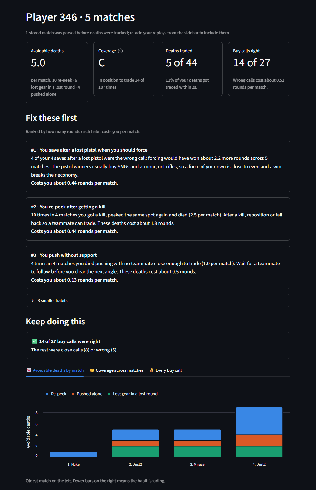

# Halftime

A decision coach for CS2: it grades your decisions, not just your aim.

Most stat sites report what happened. Halftime answers "what should I have done?". It reads your match demos and judges the decisions you control: every death (was it avoidable, did anyone trade you?), how well you cover teammates when they take a fight, and every force-or-save buy call. Each verdict comes with the facts behind it and what to do next time.

## Screenshots
Real output from real matches. Player names are replaced with stand-ins.

**Your match at a glance.** A one-line summary, four scorecards and the moments that mattered most.



**Every death, explained.** Why it was avoidable, what it cost your team's chance to win the round, and what to do next time.



**How your coverage grade is earned.** Each dot is a teammate dying near you, plotted by how far you were from his killer and how far off your aim was. Trades happen in the green box.





**Your habits across matches.** The habits that cost the most rounds, ranked, plus whether they're fading match to match.



## Features
- **Match report.** Pick one of your CS2 replays or upload a demo (`.dem`, or FACEIT's compressed `.dem.gz` / `.dem.zst`), then choose the player to review.
  - **Your deaths:** each one labelled *traded*, *avoidable* (re-peeked after a kill, pushed with nobody close enough to trade, died with gear in a lost round), *teammates didn't trade* or *lost a duel*, with the reasons, the cost to your team's round win chance, and a console command to jump to it in the demo.
  - **Coverage grade (A–F):** how often you were close enough to trade a teammate and aiming at his killer, graded against every player in the pool, with moments to repeat and to fix.
  - **Buy calls:** every force-or-save decision graded "Good call", "Close call", "Should have forced" or "Should have saved", with the rounds each wrong call cost.
  - **Economy:** both teams' equipment and buys, round by round.
- **Your habits.** Patterns across all your stored matches, ranked by rounds lost per match, e.g. *"You re-peek after getting a kill: 10 times in 4 matches."* Includes a per-match trend chart.
- **Add all replays.** One click loads every demo in your CS2 replays folder.
- Privacy and Terms pages; light and dark mode.

## How it works
1. **Parse.** demoparser2 reads each round's money and equipment, every death, and where every player stood and aimed at the moment of each death.
2. **Round win chance.** Fitted to every stored round from players alive and whether the bomb is planted, so each death has a cost (`fights.py`).
3. **Trade chance.** Fitted from how often players trade a teammate within 2 seconds, given their distance to the killer and how far their aim is from him. Only 12% of deaths in the current pool are traded that fast (`fights.py`).
4. **Buy calls.** Each round where you could force but not full-buy is played forward up to four rounds with CS2's money rules, once for forcing and once for saving (`grade.py`).
5. **Habits.** Verdicts from all your matches are grouped by situation and ranked by rounds lost (`habits.py`).

Stored matches live in PostgreSQL, and every match you open joins the pool the models are fitted to.

**Early beta:** the pool is small, and distances are straight lines (walls aren't modelled yet). Treat verdicts as a guide, not gospel.

## Stack
Python (demoparser2, pandas, NumPy), PostgreSQL, Streamlit + Altair. Planned: Power BI, Excel, AWS hosting.

## Setup (Windows, PowerShell)
```powershell
python -m venv .venv; .\.venv\Scripts\Activate.ps1
pip install -r requirements.txt
pip install -e .
copy .env.example .env      # then fill in the keys
docker compose up -d        # local PostgreSQL (the app also runs without it, using one match only)
python -m pytest            # everything should pass
```

## Usage
```powershell
# The app: match reports and your habits
streamlit run app.py

# Screenshot mode: shows stand-in names instead of players' real Steam names
$env:HALFTIME_HIDE_NAMES = "1"; streamlit run app.py

# Load demo files you already have (.dem, .dem.bz2, .dem.gz, .dem.zst; files or folders)
python -m cs2_insights.ingest "C:\Program Files (x86)\Steam\steamapps\common\Counter-Strike Global Offensive\game\csgo\replays"

# Link a player's Valve match history to see which matches are ready to analyze
python -m cs2_insights.link add https://steamcommunity.com/id/<name> CSGO-xxxxx-xxxxx-xxxxx-xxxxx-xxxxx
```

## Project layout
| Path | What it does |
|---|---|
| `app.py` | Streamlit app: match report, habits, legal pages |
| `src/cs2_insights/demo.py` | Demo parsing: rounds, teams, players, deaths and positions |
| `src/cs2_insights/fights.py` | Death verdicts, trade chance and the coverage grade |
| `src/cs2_insights/report.py` | Per-match report, reasons and key moments |
| `src/cs2_insights/grade.py` | Force-or-save grader (money simulation) |
| `src/cs2_insights/habits.py` | Patterns across matches |
| `src/cs2_insights/rates.py` | Pooled win rates and the equipment win curve |
| `src/cs2_insights/db.py`, `ingest.py` | PostgreSQL storage and bulk loading |
| `sql/schema.sql` | Database schema |
| `docs/screenshots/` | README pictures (taken in screenshot mode) |
| `legal/` | Privacy policy and terms (drafts) |

---
Not affiliated with or endorsed by Valve Corporation. Counter-Strike and CS2 are trademarks of Valve Corporation.
