# Getleanpeek

A decision coach for CS2: it grades your decisions, not just your aim.

Most stat sites report what happened. Getleanpeek answers "what should I have done?". It reads your match demos and judges the decisions you control: every death (was it avoidable, did anyone trade you?), how well you cover teammates, your grenades and flashes, your clutches, your opening duels, and every force-or-save buy call. Each verdict comes with the facts behind it, a picture of the moment, and what to do next time. Pick one habit to work on and watch it change match by match.

## Screenshots
Real output from real matches. Player names are replaced with stand-ins.

**Getting started.** New players get four steps from downloading a match to their first report.

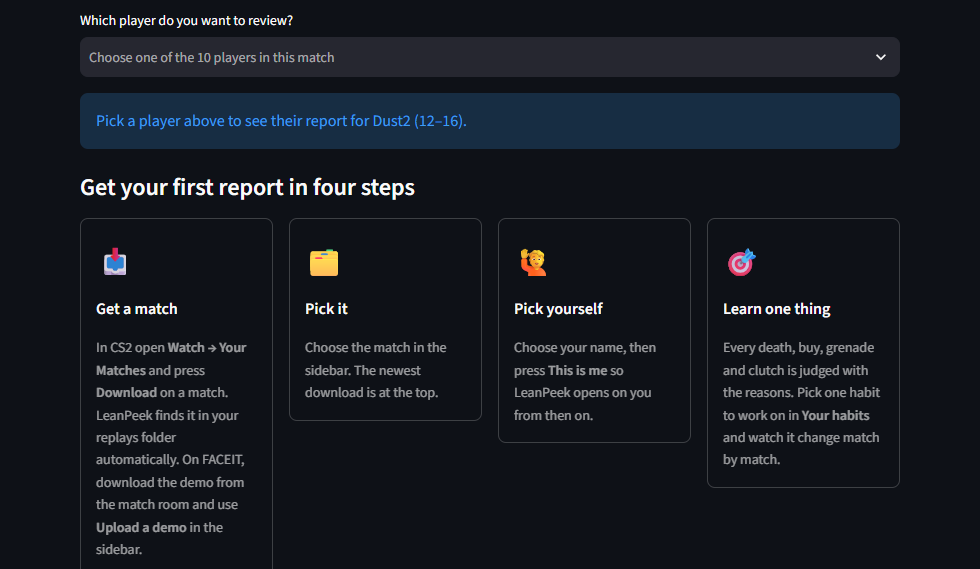

**Your match at a glance.** A one-line summary, four scorecards (compared with your last 5 matches once you have them), a clickable round timeline and the moments that mattered most.

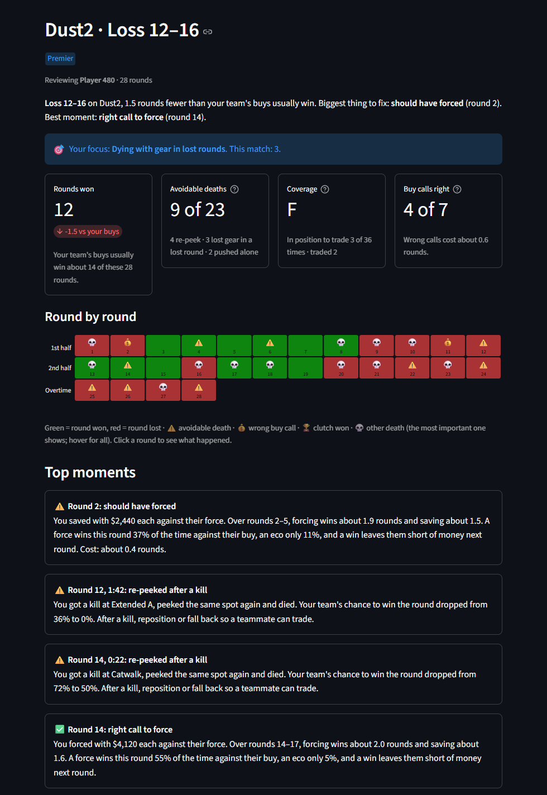

**Every death, explained.** Why it was avoidable, what it cost your team's chance to win the round, what to do next time, and a compact top-down moment map of where everyone stood and aimed.

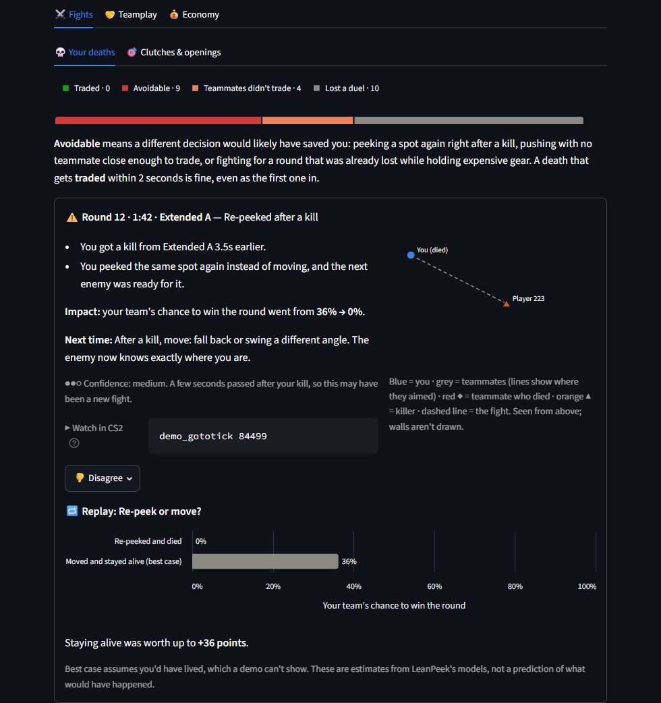

**How your coverage grade is earned.** Each dot is a teammate dying near you, plotted by how far you were from his killer and how far off your aim was. Trades happen in the green box.

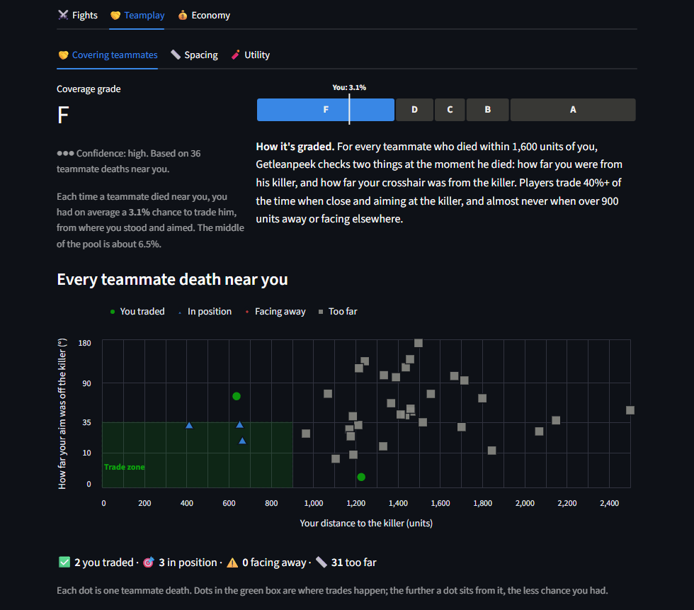

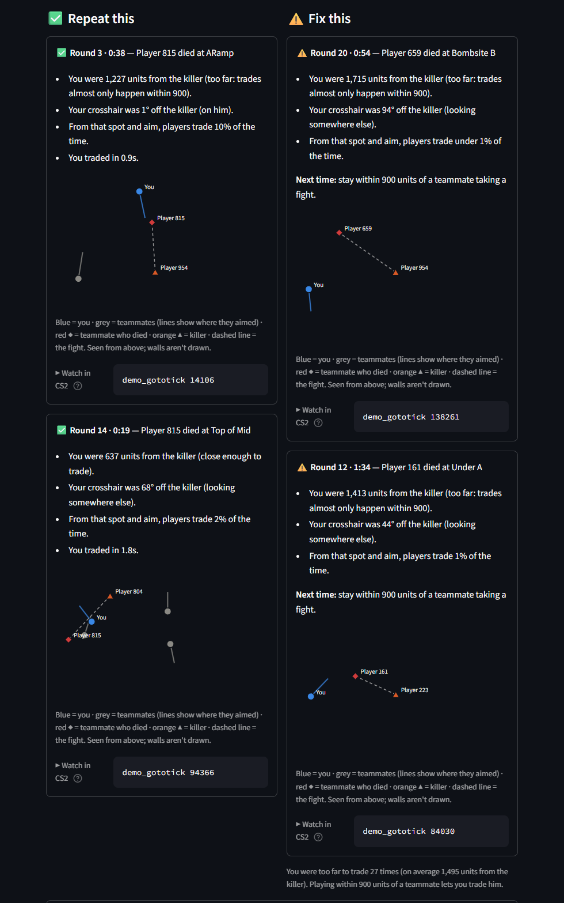

**Spacing.** How far your nearest teammate was when you died, against how often each distance gets traded.

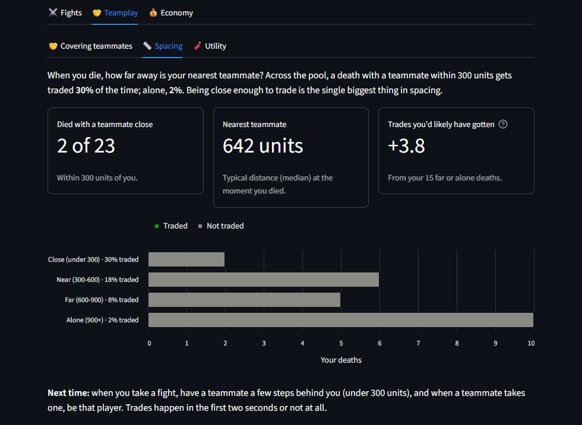

**Your grenades and flashes.** Thrown, enemies and teammates flashed, damage, and deaths with grenades still in your pocket, all against the match average. Every flash that blinded a teammate gets a verdict and a picture of where everyone stood.

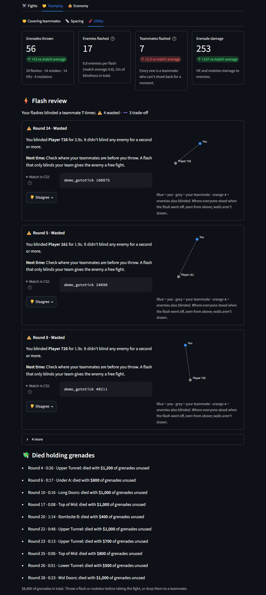

**Second-half plan.** Three things to change, written only from the first half, then whether you did them.

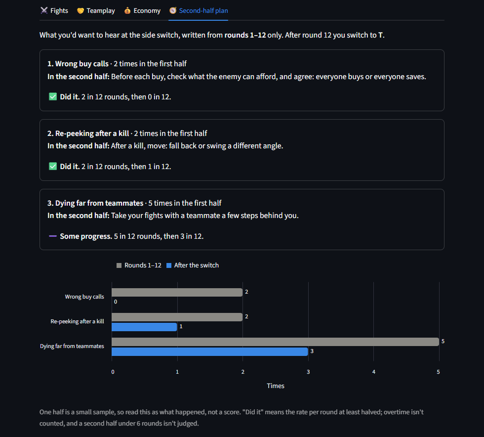

**Clutches.** Every round you were last alive: was fighting or saving right, given your chance to win, the bomb timer and what your gear was worth over the next few rounds? A replay chart shows what each option was worth.

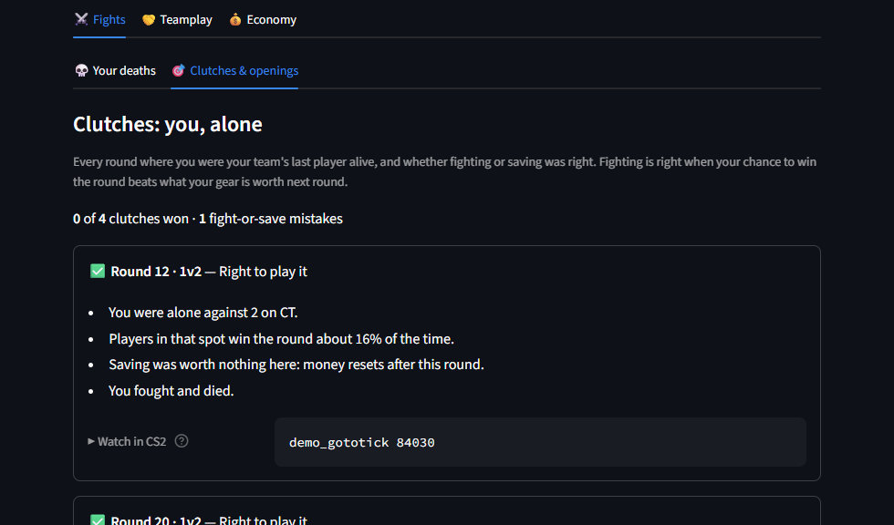

**Your habits and your focus.** A recap of your last few matches against the ones before, the habits that cost the most rounds, a short checklist for your next match, and one habit you've chosen to work on, tracked match by match, with a card to share when it really improves.

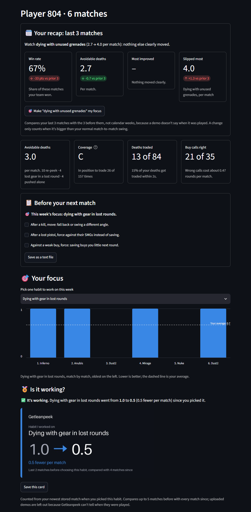

**Duo report.** Pick a regular teammate and see who covers whom, how far apart you play, and what your flashes do to each other.

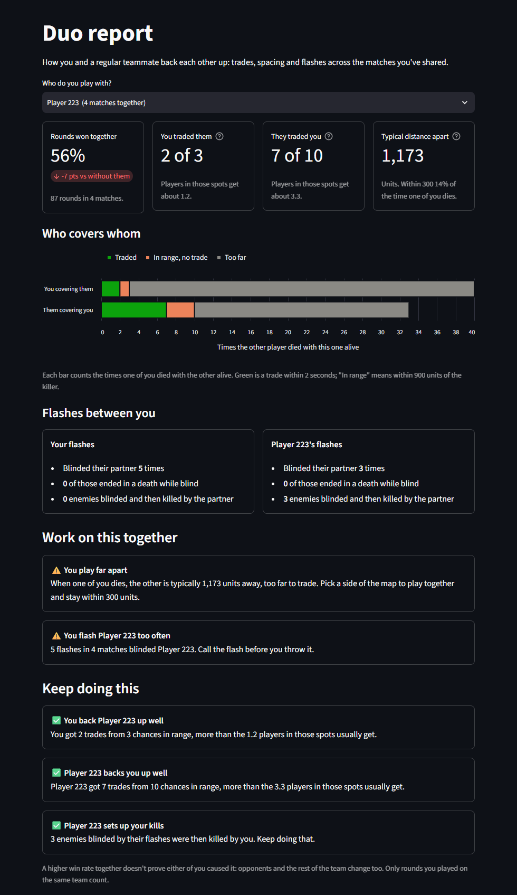

**How accurate is it?** The models tested on matches they haven't seen. Dots on the dashed line mean the odds are honest.

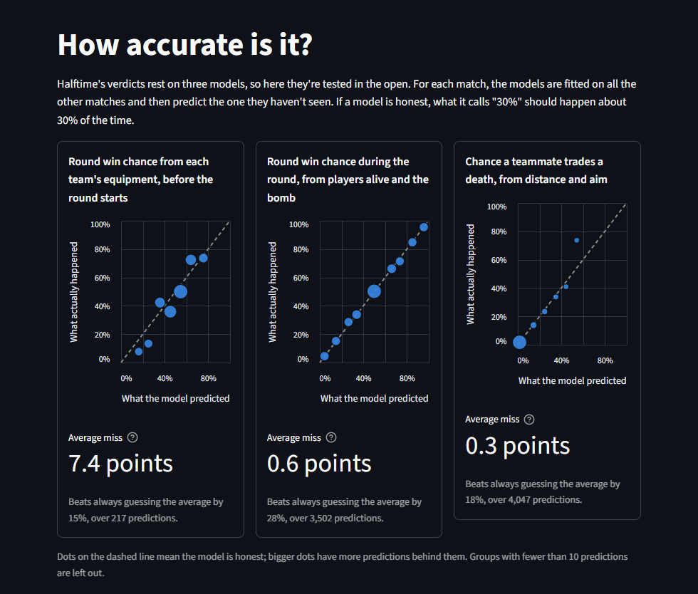

**Maps and sides.** Where your mistakes happen: avoidable deaths on each map, and every kind of miss on CT against T.

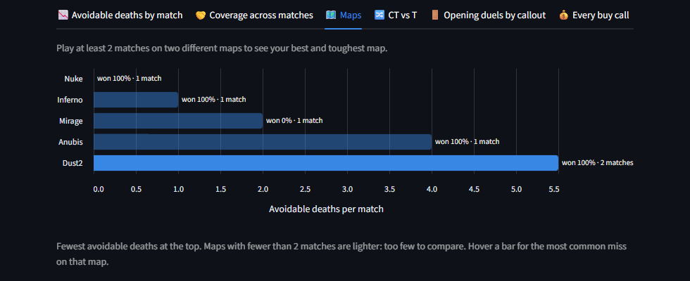

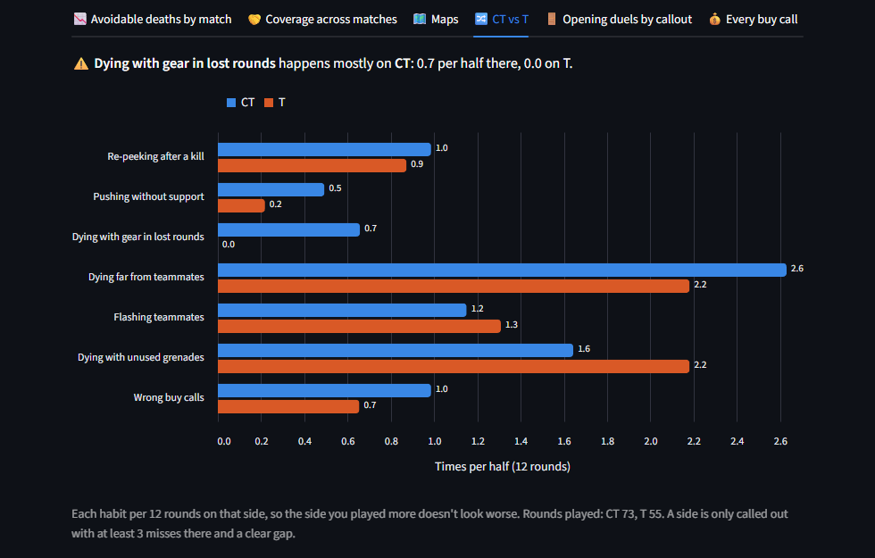

**Opening duels by callout.** Where you take the first fight of the round on each map, and how often you win it.

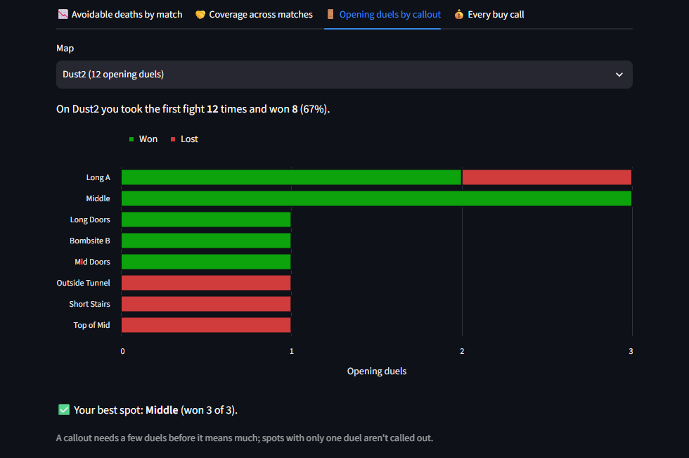

## Features
- **Match report.** Pick one of your CS2 replays or upload a demo (`.dem`, or FACEIT's compressed `.dem.gz` / `.dem.zst`), then choose the player to review. Uploads are checked first (wrong, CS:GO, renamed or cut-off files get a clear message), analysing shows each step as it happens, a demo that stops before anyone won is flagged so a partial report isn't mistaken for the whole match, and read errors are explained in plain words. Press **This is me** once and Getleanpeek opens on you from then on. A **round timeline** marks every round you won or lost, with icons for avoidable deaths, wrong buy calls and won clutches; click a round to see its full story, with your team's win chance traced through every death and the bomb plant, and the moment the round was won or lost. The details sit in four tabs: **Fights** (deaths, clutches & openings), **Teamplay** (coverage, spacing, utility), **Economy** (buy calls, round by round) and the **Second-half plan**.
  - **Your deaths:** each one labelled *traded*, *avoidable* (re-peeked after a kill, pushed with nobody close enough to trade, died with gear in a lost round), *teammates didn't trade* or *lost a duel*, with the reasons, the cost to your team's round win chance, a moment map, and a one-click-copy console command to jump to it in the demo.
  - **Coverage grade (A–F):** how often you were close enough to trade a teammate and aiming at his killer, graded against every player in the pool, with moments to repeat and to fix.
  - **Spacing:** how far your nearest teammate was each time you died, and how often deaths at that distance get traded across the pool (about 30% within 300 units, 2% alone), with the trades you'd likely have gotten by playing closer. Crossfires are shown but not graded: in the pool so far they didn't lead to more quick trades than playing the same line (see `decisions.md`).
  - **Utility:** grenades thrown, enemies flashed per flash, teammates flashed, grenade damage, and deaths with unused grenades, against the match average. The **flash review** judges every flash that blinded a teammate: *cost a teammate* (they died still blind), *wasted* (no enemy caught) or *trade-off* (it caught an enemy too).
  - **Second-half plan:** up to three things to change, chosen only from rounds before the side switch, each with what to do and whether the second half followed through. Compared per round; one half is a small sample, so it reports what happened rather than scoring you.
  - **Clutches & openings:** a fight-or-save verdict for every 1vX, and every opening duel you were in.
  - **Buy calls:** every force-or-save decision graded "Good call", "Close call", "Should have forced" or "Should have saved", with the rounds each wrong call cost.
  - **Economy:** both teams' equipment and buys, round by round.
- **Replay the decision.** Avoidable deaths, wrong buy calls and fight-or-save clutches show what each option was worth, as a chart with one bar per choice and the one you made in blue. For a death, it compares what happened with the same death with a teammate close enough to trade (at the rate those get traded across the pool) and with staying alive, labelled a best case because a demo can't show you'd have survived. When a lost-cause death's numbers favour fighting on, the replay says so and the "hide next time" advice is dropped.
- **Disagree button.** Verdict cards let a player flag a call that looks wrong and say why (a wall or smoke, it was the right play, the facts look wrong). Answers feed `analytics.v_verdict_feedback`, which shows the operator which verdicts get rejected most.
- **Duo report.** For any teammate you've shared matches with: round win rate together against without them, trades each way against what players in those spots usually get, how far apart you play, flashes on each other, and kills set up by a flash. It ends with what to work on together and what to keep doing. Follows the match-type filter.
- **How accurate is it?** A page that tests the models in the open: for each match they're fitted on the others and predict the one they haven't seen, with charts of predicted against actual and notes on what the test doesn't prove.
- **"How sure are we?" labels.** Avoidable deaths, clutches, buy calls, coverage grades and habits each carry a high, medium or low label with a one-line reason, so a tip from thin evidence doesn't look as solid as one with plenty behind it. These are rules of thumb, not statistical guarantees.
- **Hosted mode.** Google sign-in, each player sees only the matches they added, and nothing shows without a login. `DEPLOY.md` walks through a free deployment on Streamlit Community Cloud with a Neon database in the US (Ohio).
- **Match types.** Premier, Competitive and FACEIT are detected from each demo and kept apart: every report is labelled, the replay list can be filtered, and Your habits can be viewed for one type at a time (the recap, focus chart and habits all follow). FACEIT detection reads the server name and hasn't been tested on a real FACEIT demo yet.
- **Your habits.** Patterns across your matches (including dying far from your teammates and flashing them for nothing), ranked by rounds lost per match and compared with every player in the pool, e.g. *"You re-peek after getting a kill: 10 times in 4 matches."*
  - **Recap:** your last matches (up to 5) against the same number before them: win rate, avoidable deaths, what improved most, what slipped most, and one click to make the slip your focus. It compares matches rather than calendar weeks because a demo doesn't say when it was played; a change only counts when it's bigger than your normal match-to-match swing.
  - **Before your next match:** your top habits as a short checklist of actions, with your focus, that you can tick off or save as a text file for a second screen.
  - **Weekly focus:** pick one habit (re-peeks, pushing alone, dying far from teammates, team flashes, coverage, ...) and see it per match against your average, with a reminder on every match report.
  - **Habit proof:** once you've played 3 matches since picking a focus, it compares them with up to 5 from before and says whether the habit improved, slipped or stayed within your normal swing. A real improvement gets a shareable image with the numbers and no player name.
  - **Trend charts:** avoidable deaths per match, coverage across matches, and opening duels by callout per map.
  - **Maps:** avoidable deaths per match and win rate on each map, your best and toughest map (once you have two matches on two maps), and the most common miss on the toughest one with what to do about it.
  - **CT vs T:** every kind of miss per 12 rounds on each side, with a note when one side is clearly worse.
- **Add all replays.** One click loads every demo in your CS2 replays folder.
- **First-run guide.** Four steps from downloading a match to your first report; it tucks itself away once you've saved yourself with **This is me**.
- **Your data.** Forget your player (your Steam ID is replaced by a random one and your name removed in every stored match) or delete your account's settings, usage history and disagreements. Both need a typed confirmation.
- Works on phones (checked at iPhone width: no sideways scrolling, cards stack). Privacy and Terms pages; light and dark mode.

## How it works
1. **Parse.** demoparser2 reads each round's money and equipment, every death, where every player stood and aimed at each death, every grenade and flash, and the bomb plant.
2. **Round win chance.** Fitted to every stored round from players alive and whether the bomb is planted, so each death has a cost (`fights.py`).
3. **Trade chance.** Fitted from how often players trade a teammate within 2 seconds, given their distance to the killer and how far their aim is from him. Only 12% of deaths in the current pool are traded that fast (`fights.py`).
4. **Clutches.** When you're last alive, your chance to win the round (players alive, the bomb, and whether a CT still has time to defuse) is weighed against what keeping your gear is worth over the rest of the half: the economy is simulated up to 4 rounds ahead with and without the gun, because a saved gun keeps paying off in later buys. Fighting is right when your win chance beats S / (1 + S), since winning keeps the gun too (`fights.py`).
5. **Buy calls.** Each round where you could force but not full-buy is played forward up to four rounds with CS2's money rules, once for forcing and once for saving (`grade.py`).
6. **Habits and progress.** Verdicts from all your matches are grouped by situation and ranked by rounds lost (`habits.py`), and tracked match by match (`progress.py`).

Stored matches live in PostgreSQL, and every match you open joins the pool the models are fitted to.

**Tested on unseen matches** (12 matches; `python -m cs2_insights.calibration`). Average miss between predicted and actual: 0.6 points for mid-round win chance, 0.3 for trade chance, 7.4 for pre-round win chance from equipment, which has far fewer predictions. The trade figure flatters the model, since most of its predictions sit near 0%; its rare high predictions are less reliable. This checks the odds, not the simulated "what if" behind buy calls.

**Early beta:** the pool is small, and distances are straight lines (walls aren't modelled yet). Treat verdicts as a guide, not gospel.

## Dashboards (Power BI)
Every stored match also feeds a star schema in PostgreSQL (`analytics` schema, `sql/analytics.sql`) that Power BI reads directly. It is rebuilt by the same Python logic as the app, so a dashboard never disagrees with a match report.

| Table | One row per |
|---|---|
| `dim_player`, `dim_match` | player; match (with `match_order`, oldest = 1) |
| `fact_player_match` | player per match: deaths, avoidable deaths, coverage, utility, clutches, opening duels, buy calls |
| `fact_death`, `fact_clutch`, `fact_opening`, `fact_buy_call` | death; clutch; opening duel; force-or-save decision |

**Business metrics.** The app records product usage in `app_events` (report viewed, demo uploaded, replays added, habits viewed, round opened, "This is me" saved, focus set, checklist saved, progress card saved, duo report viewed; no names, IPs or device details; disclosed in the privacy policy). Views on top: `v_usage_daily`, `v_funnel` (opened app → viewed a report → opened habits → saved themselves), `v_feature_use` and `v_retention_weekly`. Turn tracking off with `HALFTIME_NO_TRACKING=1`.

**Who can see this.** Dashboards are for the operator, never users: no app page reads these tables, and Power BI should log in through the `analytics_reader` role, which can read the `analytics` schema and nothing else (no raw events, no Steam auth codes). When hosted, the tables are rebuilt with the analytics command rather than during a user's request, and usage is counted per account using a scrambled ID.

The tables refresh automatically when matches are added (the ingest command or **Add all replays**), or by hand with `python -m cs2_insights.analytics`.

## Stack
Python (demoparser2, pandas, NumPy), PostgreSQL, Streamlit + Altair. Planned: Power BI, Excel, AWS hosting.

## Setup (Windows, PowerShell)
```powershell
python -m venv .venv; .\.venv\Scripts\Activate.ps1
pip install -r requirements.txt
pip install -e .
copy .env.example .env      # then fill in the keys
python -m cs2_insights.secretbox --new-key   # add the printed HALFTIME_SECRET_KEY to .env (encrypts Steam auth codes)
docker compose up -d        # local PostgreSQL (the app also runs without it, using one match only)
python -m pytest            # everything should pass
```

## Usage
```powershell
# The app: match reports and your habits
streamlit run app.py

# Screenshot mode: shows stand-in names instead of players' real Steam names
$env:HALFTIME_HIDE_NAMES = "1"; streamlit run app.py

# Rebuild the Power BI tables by hand (adding matches does this automatically)
python -m cs2_insights.analytics

# Hosted mode: per-user matches and settings, behind Google sign-in. See DEPLOY.md to put it online for free.
$env:HALFTIME_HOSTED = "1"; streamlit run app.py

# Load demo files you already have (.dem, .dem.bz2, .dem.gz, .dem.zst; files or folders)
python -m cs2_insights.ingest "C:\Program Files (x86)\Steam\steamapps\common\Counter-Strike Global Offensive\game\csgo\replays"

# Encrypt any Steam auth codes saved before encryption existed (one-off)
python -m cs2_insights.link encrypt

# Link a player's Valve match history to see which matches are ready to analyze
python -m cs2_insights.link add https://steamcommunity.com/id/<name> CSGO-xxxxx-xxxxx-xxxxx-xxxxx-xxxxx
```

## Project layout
| Path | What it does |
|---|---|
| `app.py` | Streamlit app: match report, habits, legal pages |
| `src/cs2_insights/demo.py` | Demo parsing: rounds, teams, players, deaths, positions, grenades and flashes |
| `src/cs2_insights/fights.py` | Death verdicts, trade chance, coverage grade, clutches and opening duels |
| `src/cs2_insights/recap.py` | Your latest matches against the ones before |
| `src/cs2_insights/cards.py` | Shareable match card image |
| `src/cs2_insights/categories.py` | Premier, Competitive and FACEIT match categories |
| `src/cs2_insights/duo.py` | How two teammates back each other up |
| `src/cs2_insights/breakdown.py` | Where your misses happen: CT or T, and on which maps |
| `src/cs2_insights/roundchain.py` | Win chance through a round, and the moment it swung |
| `src/cs2_insights/halfplan.py` | What to change after the first half, and whether it changed |
| `src/cs2_insights/proof.py` | Whether a focus habit changed since it was picked, and the shareable card |
| `src/cs2_insights/replay.py` | What each option in a decision was worth |
| `src/cs2_insights/utility.py` | Grenade and flash summary per match, and the team flash review |
| `src/cs2_insights/progress.py` | Match-by-match history for progress and the weekly focus |
| `src/cs2_insights/report.py` | Per-match report, reasons and key moments |
| `src/cs2_insights/grade.py` | Force-or-save grader (money simulation) |
| `src/cs2_insights/habits.py` | Patterns across matches |
| `src/cs2_insights/privacy.py` | Deleting an account's data and forgetting a player |
| `src/cs2_insights/calibration.py` | Tests the models on matches they haven't seen |
| `src/cs2_insights/spacing.py` | Spacing (nearest teammate when you die) and crossfire measurements |
| `src/cs2_insights/confidence.py` | "How sure are we?" labels on verdicts |
| `src/cs2_insights/rates.py` | Pooled win rates and the equipment win curve |
| `src/cs2_insights/db.py`, `ingest.py` | PostgreSQL storage and bulk loading |
| `src/cs2_insights/analytics.py`, `sql/analytics.sql` | Power BI star schema, rebuilt from stored matches |
| `sql/schema.sql` | Database schema |
| `docs/screenshots/` | README pictures (taken in screenshot mode) |
| `legal/` | Privacy policy and terms (drafts) |

---
Not affiliated with or endorsed by Valve Corporation. Counter-Strike and CS2 are trademarks of Valve Corporation.
